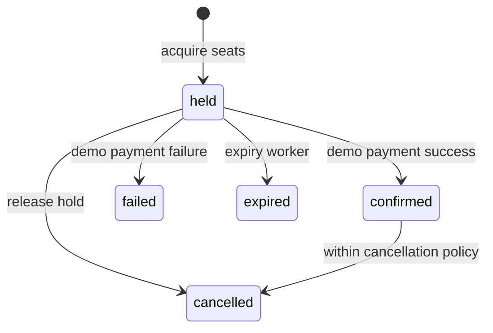

# Architecture and data integrity

## Data model

All schemas include creation/update timestamps. Mongoose pluralizes collection names.

| Collection    | Key fields and links                                                       | Indexes                                                         |
| ------------- | -------------------------------------------------------------------------- | --------------------------------------------------------------- |
| Users         | name, normalized email, password hash, role, tokenVersion                  | unique email                                                    |
| Movies        | title, synopsis, genres, language, runtime, release date, poster, active   | title/synopsis text; active/language/genres                     |
| Theatres      | one document per screen: venue, location, address, rows, columns           | location/active                                                 |
| Shows         | movie, theatre, UTC startsAt/endsAt, paise price, active, inventoryVersion | movie/active/startsAt; theatre/startsAt                         |
| Seats         | show, label, status, booking, expiresAt                                    | unique show/label; show/status/expiresAt                        |
| Bookings      | user, show, seat labels, amount, currency, reference, status, expiresAt    | unique reference; user/createdAt; status/expiresAt; show/status |
| Payments      | booking, user, amount, provider, reference, status                         | unique booking; unique reference                                |
| Notifications | user, booking, message, read                                               | user/createdAt                                                  |

Shows link to theatre layout and timing; availability lives in the indexed Seats collection rather than duplicating mutable availability counts in Shows. Seat inventory is generated as a per-show snapshot at creation. Theatres represent individual screens, so create multiple theatre documents for a venue with multiple screens.

## Seat allocation

1. A transaction locks the show by incrementing its inventory version and verifies that it is active and in the future.
2. It assigns only requested seats whose status is available or whose hold has expired.
3. The number of modified seats must equal the requested count. Otherwise the entire transaction rolls back, including partially acquired seats.
4. It creates a held booking with a server-calculated amount and expiry.
5. After commit, Socket.IO emits a public seat snapshot to the show room. User IDs and hold ownership are never broadcast.

MongoDB transient transaction retries resolve concurrent writes. The common show write serializes conflicting show administration, holds, confirmation and cancellation. Unique `(show, label)` indexes prevent duplicate inventory.

Clients receive snapshots when they join/reconnect. The database remains authoritative when a user continues, including when a socket event is delayed or missed. A browser selection alone is not a hold; the hold starts when the booking API succeeds.

## Booking lifecycle

A held seat is reclaimable at expiry even if the cleanup worker has not run. Cleanup runs every 10 seconds in batches of 100 and only releases seats whose booking ID still matches the expired booking. It cannot release a newer customer's hold. Booking/payment history has no TTL index: deleting audit history is inappropriate.

Payment validates the booking owner, current status, show availability, hold deadline and exact seat ownership. It atomically confirms booking/seats, records one payment and adds a notification. Repeated success requests return the already-confirmed booking. A failed payment ends the booking; retry means starting a new seat hold.

Cancellation is idempotent. A confirmed ticket can be cancelled until the configured cutoff (60 minutes before showtime by default). Held bookings can be released directly. Demo refunds are recorded in the same transaction; no actual funds move.

## Admin lifecycle and concurrency

Movie and theatre edits acquire their respective version write inside a transaction. Creating/updating a show acquires the same movie and theatre writes, preventing concurrent archival or layout changes. Show overlaps on a screen are checked in that transaction. Admin show mutations take the same show inventory write as booking operations. Existing held or confirmed bookings block show edits and archival, even if an expired hold has not yet been processed by cleanup (usually up to 10 seconds).

Records are archived with `active: false`, preserving references from historical bookings. Historical movie titles are references rather than immutable ticket snapshots; catalogue edits after shows finish can change the title shown on an old ticket. For formal accounting, add immutable movie/theatre/title snapshots to bookings.

## Query performance

- Show and booking queries use compound filters aligned with indexes.
- Seats use unique show/label lookups and status/expiry indexes.
- Lists use bounded pagination (default 12, maximum 50). Deep offset pagination can be replaced with cursor pagination at scale.
- Title search uses a bounded escaped case-insensitive substring regex for intuitive matching. It is not accelerated by the supplied text index. Use `$text` for token matching or Atlas Search for scalable autocomplete and fuzzy search. Location regex matching has the same scaling caveat.
- Available counts are intentionally derived from seat inventory; no stale counter is maintained.
- Admin selectors retrieve all catalogue pages. Large catalogues should use server-side searchable selectors.

## Operational boundaries

This project implements one API process. Socket room state and rate limits are in memory. Use a shared Socket.IO adapter and distributed rate-limit store before horizontal scaling. Coordinate expiry scheduling; transaction guards make duplicate expiry attempts safe, but a dedicated worker avoids unnecessary contention. Persist important events in an outbox for guaranteed delivery; this demo's sockets are best-effort and notifications are in-app only.

For real payments, external provider operations cannot be placed inside a MongoDB transaction. Use pending payment state, idempotent verified webhooks, compensation/refund workflows, a reconciliation job, and observability. Provider transactions must be bound to a specific booking and amount, with an explicit policy for late confirmations after a hold expires.

App logs redact authentication headers/cookies and never log request bodies. Retention, access controls, backups and TLS for the database are deployment responsibilities. The local Docker MongoDB is deliberately bound to loopback and has no authentication; it is a development setup.

References: [MongoDB transactions](https://www.mongodb.com/docs/manual/core/transactions/) and [Socket.IO rooms](https://socket.io/docs/v4/rooms/).
